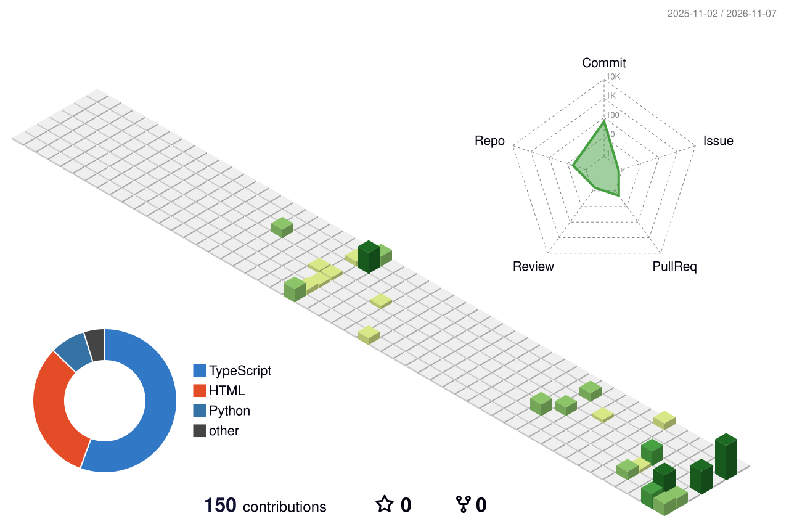
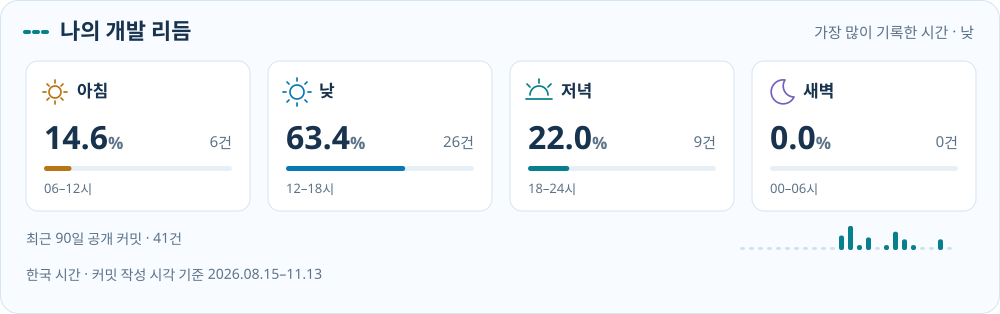

  <picture>
    <source media="(max-width: 600px)" srcset="./assets/profile-header-mobile.svg?v=project-overview-3">
    
  </picture>
    
  
  &nbsp;
  
  &nbsp;
  

 

**AI와 함께 웹·모바일 서비스를 만들며, 사용자의 불편을 해결하는 경험을 쌓아 가는 개발자입니다.**

- 🧩 데이터 수집부터 API와 화면 연동까지, 서비스를 연결하는 경험을 쌓았다.
- 🔎 계약서 분석·정책 검토처럼 자료를 읽고 판단을 돕는 서비스에 관심이 있다.
- 🌱 AI를 실제 업무에 적용하는 **AX 엔지니어**를 목표로 한다.

## 🛠️ Tech & Tools

AI 도구와 함께 프로젝트에서 활용한 기술과 개발 도구를 정리했다.

<table>
<tr>
<td width="130"><b>Languages</b></td>
<td>  </td>
</tr>
<tr>
<td width="130"><b>Frontend</b></td>
<td>   </td>
</tr>
<tr>
<td width="130"><b>Backend &amp; Database</b></td>
<td> </td>
</tr>
<tr>
<td width="130"><b>AI &amp; LLM</b></td>
<td>  </td>
</tr>
<tr>
<td width="130"><b>Tools</b></td>
<td>   </td>
</tr>
</table>

## 🏆 수상

| 시기 | 대회 | 수상 |
| :--- | :--- | :--- |
| 2026.10 | 2026 SUMTECH Hackathon | **특별상** · 한국디지털콘텐츠학회장상 |
| 2026.08 | 인천대·울산대 초광역 지역문제 해결형 해커톤 | **장려상** |
| 2025.12 | AI 및 빅데이터를 활용한 산업특화 아이디어 공모전 | **장려상** |

## 🧩 만들고 연결한 프로젝트

AI 도구와 함께 개발한 프로젝트다. 각 카드에는 본인이 담당한 경험을 정리했다. [프로젝트별 주요 작업](docs/CONTRIBUTIONS.md)에서 관련 코드와 개발 내용을 확인할 수 있다.

<table>
<tr>
<td width="50%" valign="top">
<h3>⚖️ <a href="https://github.com/ulsanung-del/legal-screening-assistant">Deepgle Legal</a></h3>

계약서의 위험 조항과 근거 법령을 확인하는 AI 분석 서비스다.

<b>담당 · 데이터 수집·프론트엔드·백엔드</b>

<ul><li>데이터 수집·정리 및 분석 API 개발</li><li>문서 업로드부터 분석 결과 화면까지 연결</li></ul>

데이터 수집 / API / 웹 서비스

</td>
<td width="50%" valign="top">
<h3>🔎 <a href="https://github.com/rokmc1893/INU-X-UOU">정책핏 인천</a></h3>

산업 수요와 정책을 비교해 검토서 초안을 만드는 정책 분석 앱이다.

<b>담당 · 데이터 조사·검증 설계</b>

<ul><li>정책의 담당 부서·예산 대조 자료 정리</li><li>정답셋과 MVP 평가 기준 구성</li></ul>

정책 데이터 / 검증 설계

</td>
</tr>
<tr>
<td width="50%" valign="top">
<h3>🐢 <a href="https://rokmc1893.github.io/rokmc1893/#projects">패스트거북이</a></h3>

작업 중 자세 변화를 확인하고 지속적인 이탈을 알려주는 웹 서비스다.

<b>담당 · 프론트엔드·데이터 연동·자료 조사</b>

<ul><li>주요 화면 개발 및 측정 데이터 연동</li><li>자세 측정 관련 논문·근거 자료 조사</li></ul>

프론트엔드 / 데이터 연동

</td>
<td width="50%" valign="top">
<h3>🤝 <a href="https://github.com/US-VIBE/us_vibe">US Vibe</a></h3>

AI 팀원과 협업하고 산출물 리뷰·회고를 연습하는 학습 시뮬레이터다.

<b>담당 · 프론트엔드 전반 개발</b>

<ul><li>워크스페이스·채팅·리뷰·회고 화면 개발</li><li>백엔드 API 연동 및 화면 상태 처리</li></ul>

프론트엔드 / API 연동

</td>
</tr>
</table>

<b>프로젝트별 상세 기여와 사용 기술</b>

### [Deepgle Legal](https://github.com/ulsanung-del/legal-screening-assistant)

계약서의 위험 조항과 근거 법령을 함께 확인하는 AI 분석 서비스다.

**담당 경험** · 데이터 수집·API·프론트엔드·백엔드 개발

- 계약서 분석에 필요한 데이터를 수집하고 서비스에서 활용할 수 있도록 정리했다.
- 문서 업로드·분석 요청·결과 조회 API와 백엔드 처리 흐름을 개발했다.
- 프론트엔드 주요 화면을 구현하고, 분석 요청부터 결과 확인까지의 흐름을 연결했다.

**프로젝트 사용 기술** · FastAPI · Gemini · LangGraph · Chroma · React 
2026 Google AI Agent Challenge 참가

### [정책핏 인천](https://github.com/rokmc1893/INU-X-UOU)

산업 수요와 정책을 비교해 지원 공백·중복 후보를 찾고 검토서 초안을 만드는 앱이다.

**담당 경험** · 데이터 조사 및 검증 설계

- 정책의 담당 부서·예산 대조 자료를 정리했다.
- 검증용 정답셋과 MVP 평가 기준을 구성하고 발표 수치·한계·Q&A를 검토했다.
- 관련 조사 자료는 [F4](https://github.com/rokmc1893/F4), 후속 제품은 [정책핏 인천](https://github.com/rokmc1893/INU-X-UOU)에서 관리했다.

**프로젝트 사용 기술** · Python · Streamlit · Neo4j · OpenAI 
인천대·울산대 초광역 지역문제 해결형 해커톤 장려상

### 패스트거북이

노트북 작업 중 개인 기준 자세의 변화를 확인하고, 지속적인 이탈을 알려주는 웹 서비스다.

**담당 경험** · 프론트엔드 개발·데이터 연동·근거 자료 조사

- 기준 자세 등록·자세 변화 확인·알림·리포트 등 주요 기능의 프론트엔드를 개발했다.
- 화면에 필요한 데이터를 연동해 측정 상태와 결과를 표시했다.
- 자세 측정과 판단 기준에 관한 논문·근거 자료를 조사하고, 기능 설계에 참고할 내용을 정리했다.

2026 SUMTECH Hackathon 특별상(한국디지털콘텐츠학회장상)

### [US Vibe](https://github.com/US-VIBE/us_vibe)

AI 팀원과 역할 분담·채팅·산출물 리뷰·회고를 연습하는 학습 시뮬레이터다.

**담당 경험** · 프론트엔드 전반 개발

- 워크스페이스·채팅·산출물 리뷰·회고 등 서비스 전반의 프론트엔드를 개발했다.
- 백엔드 API를 화면과 연결하고, 사용자 입력·로딩·오류에 따른 화면 상태를 처리했다.

**프로젝트 사용 기술** · Next.js · React · TypeScript 
팀 프로젝트

<b>웹·모바일 프로젝트 더 보기 · 배웅길 / 헬스케어 / Ulsainer</b>

### 배웅길

반려동물 장례시설을 찾고 조건별 비용을 비교하는 모바일 웹 서비스다.

**담당 경험** · 1인 사이드 프로젝트

- AI 도구를 활용해 시설 탐색·비용 비교 화면과 API를 개발했다.
- 시설 데이터 수집·정규화, 카카오 로그인·회원 관리, 사진 추모영상 기능을 연결했다.

**프로젝트 사용 기술** · React · TypeScript · FastAPI · Supabase 
개인 프로젝트 · 코드 비공개

### [결혼·출산 준비 헬스케어](https://github.com/rokmc1893/Capstone-Design)

건강 지표와 검사 결과를 리포트로 확인하고 미션·커뮤니티를 이용하는 모바일 웹이다.

**담당 경험** · 프론트엔드 개발 및 인증·API 연동

- 온보딩·검사 설문·결과 리포트·미션·커뮤니티 화면 구현에 참여했다.
- 이메일·카카오 로그인과 API를 연동하고 진행 상태 복구·인증 만료 오류를 처리했다.

**프로젝트 사용 기술** · React · TypeScript · Vite · Zustand 
캡스톤 디자인

### Ulsainer

관광지를 탐색하고 미션·커뮤니티·방문 기록을 이용하는 모바일 앱이다.

**담당 경험** · 모바일 프론트엔드 개발 및 API 연동

- 커뮤니티·마이페이지와 게시글·댓글 기능 구현에 참여했다.
- 관광지 검색·카카오 로그인을 연동하고 미션 상태 복구와 방문 기록 지도를 개선했다.

**프로젝트 사용 기술** · React Native · Expo · TypeScript · Supabase 
2026 관광데이터 활용 공모전 참가

<b>문서·차량 업무 자동화 · 오더십 / 오토일지</b>

### 오더십(OrderShip)

선박 견적 요구사양을 분석해 기자재 후보·호환성·근거·확인 질문을 정리하는 Upstage Studio 프로젝트다.

**담당 경험** · 워크플로우 공동 설계·개선, 테스트·오류 분석, 웹앱 연동·배포

- 워크플로우·테스트셋을 공동 담당하고, 경로별 판정·수량 차이·후보 오류 처리 수정안을 정리했다.
- Studio 결과 조회·보고서·PDF와 Netlify 데모를 연결하고 제출자료·검증 문서를 정리했다.
- 20세트 기대값 기반 검증과 실제 실행 결과를 구분해 기록했다.

**프로젝트 사용 기술** · Upstage Studio · React · TypeScript · Fastify · Playwright · Netlify 
백수해적단 팀 프로젝트 · 코드 비공개

### 오토일지(AutoDiary)

현대자동차그룹 차량용 앱 개발 공모전을 위해 외근 차량의 출발·방문·음성 메모·마감을 연결하도록 개발한 Android 프로토타입이다.

**담당 경험** · 제품 흐름 설계, AI 보조 개발·통합 검증, 시연 산출물 정리

- 차량 신호 기반 7단계와 SIM 시연 범위를 정하고 Compose 화면·상태기계·Room 저장·복구를 연결했다.
- 테스트 59건·SIM 빌드·APK 서명을 검증하고, 실제 차량 SDK·내비·음성 인식의 미검증 범위를 구분했다.

**프로젝트 사용 기술** · Kotlin · Jetpack Compose · Room · Android TTS/STT 
<a href="https://appdevchallenge.auto-hmg.io/guide/submission#resubmit">현대자동차그룹 차량용 앱 개발 공모전</a> 참가 · 코드 비공개 · 차량 신호는 SIM 검증

## 🌱 매일 쌓아 가는 기록

<picture>
  <source media="(prefers-color-scheme: dark)" srcset="./profile/snake-dark.svg">
  <source media="(prefers-color-scheme: light)" srcset="./profile/snake.svg">
  
</picture>

<b>기여 기록을 3D 잔디로 보기</b>

 
<picture>
  <source media="(prefers-color-scheme: dark)" srcset="./profile-3d-contrib/profile-night-green.svg">
  <source media="(prefers-color-scheme: light)" srcset="./profile-3d-contrib/profile-green.svg">
  
</picture>

 

<picture>
  <source media="(max-width: 600px) and (prefers-color-scheme: dark)" srcset="./profile/activity-mobile-dark.svg">
  <source media="(max-width: 600px)" srcset="./profile/activity-mobile.svg">
  <source media="(prefers-color-scheme: dark)" srcset="./profile/activity-dark.svg">
  
</picture>

  

<picture>
  <source media="(prefers-color-scheme: dark)" srcset="./profile/stats-dark.svg">
  
</picture>
<picture>
  <source media="(prefers-color-scheme: dark)" srcset="./profile/top-langs-dark.svg">
  
</picture>

공개 저장소의 활동과 사용 언어를 집계한 통계다.

---

  작은 불편을 발견하고, 하나씩 연결하며, 쓸 수 있는 서비스로.

